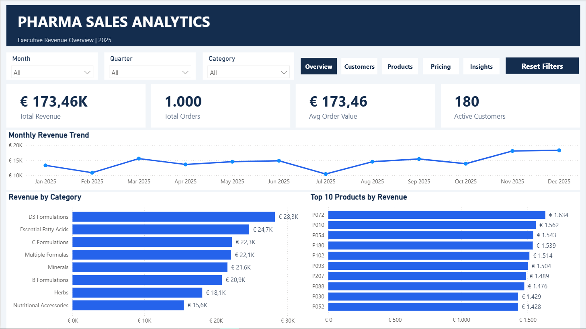
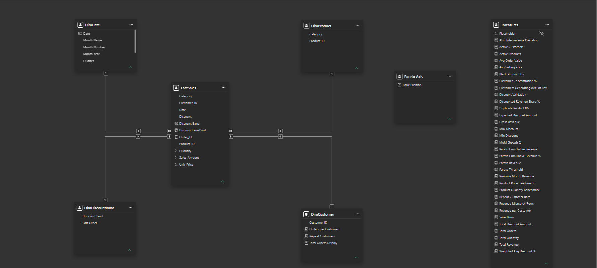
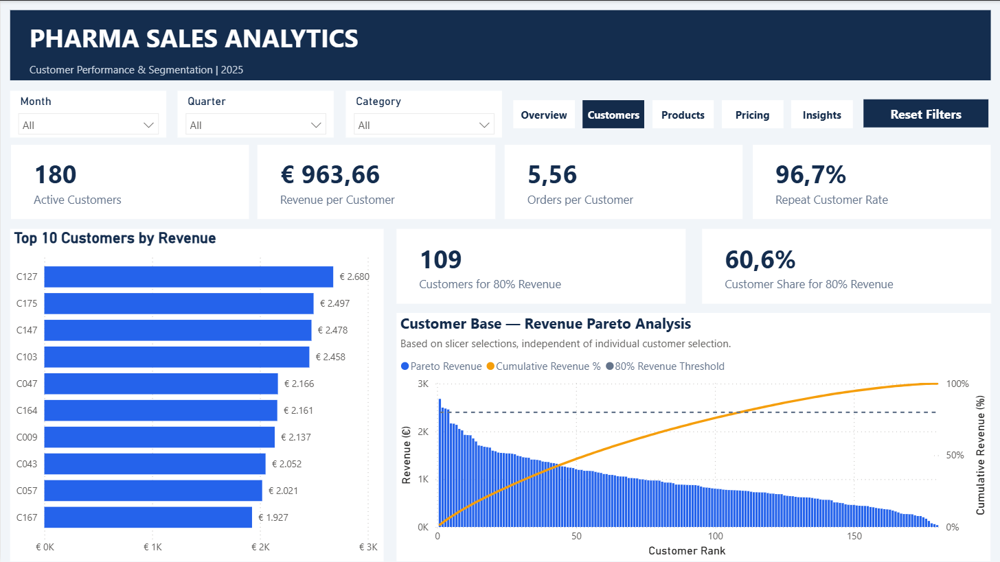
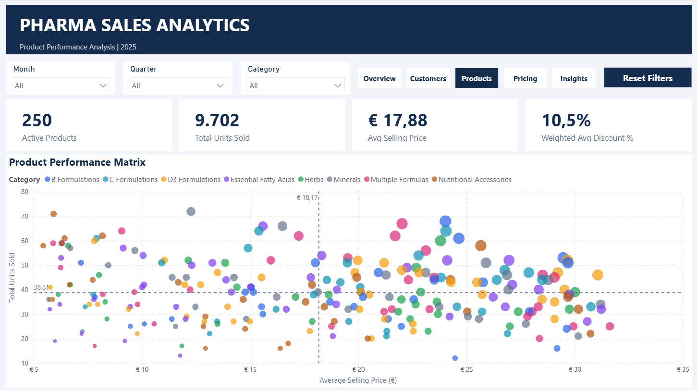
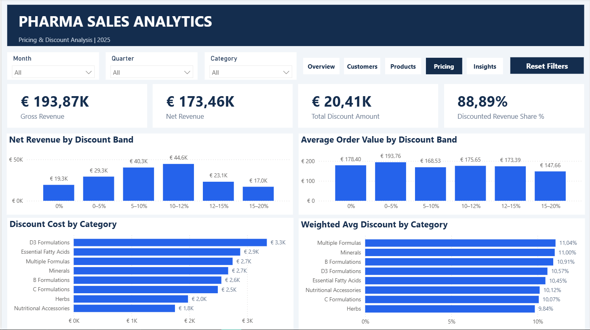
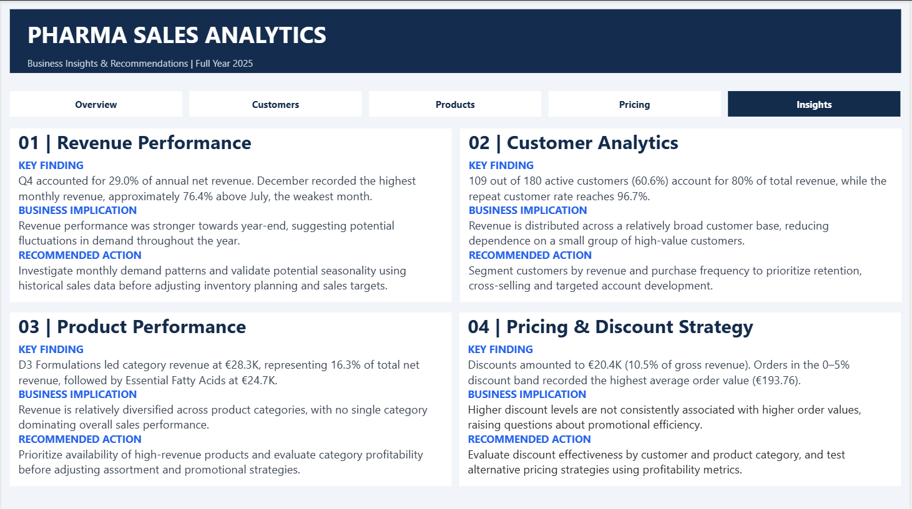

# Pharma Sales Analytics Dashboard

An end-to-end Business Intelligence project built in Power BI, designed to analyze pharmaceutical and dietary supplement sales and translate commercial data into actionable business insights.



## Project Overview

This project simulates a commercial analytics solution for a pharmaceutical and dietary supplements distribution business using synthetic sales data for the full calendar year 2025.

It combines data preparation, dimensional modeling, DAX calculations, interactive reporting, data quality validation, and business recommendations.

## Business Objectives

The project addresses four core business questions:

- **Revenue Performance:** How does sales revenue evolve throughout the year?
- **Customer Analytics:** How concentrated is revenue across the customer base?
- **Product Performance:** Which products and categories drive revenue and sales volume?
- **Pricing Strategy:** How are discount levels associated with revenue and average order value?

## Dataset Overview

The dataset contains synthetic transactional sales data.

| Metric | Value |
|---|---:|
| Reporting period | January–December 2025 |
| Sales line records | 3,629 |
| Distinct orders | 1,000 |
| Active customers | 180 |
| Active products | 250 |
| Product categories | 8 |
| Units sold | 9,702 |

Each row represents an individual sales line rather than an entire order. Order identifiers may therefore appear across multiple rows.

The source dataset is available here:

[Download Dataset](data/pharma_sales_2025.csv)

## Tools & Technologies

- Microsoft Power BI Desktop
- Power Query
- DAX (Data Analysis Expressions)
- Dimensional Modeling
- Star Schema
- CSV Data Sources
- GitHub

## Data Modeling

The semantic model follows a star schema architecture, with a central sales fact table and four supporting dimension tables.

| Table | Purpose |
|---|---|
| FactSales | Transactional sales data |
| DimDate | Calendar and time intelligence |
| DimCustomer | Customer identifiers |
| DimProduct | Product and category attributes |
| DimDiscountBand | Discount classification and sorting |
| Pareto Axis | Disconnected customer ranking table |
| _Measures | Centralized DAX measures |

The model uses one-to-many relationships with single-direction filtering from dimension tables to the fact table.

A dedicated disconnected ranking table supports dynamic customer Pareto analysis.

### Semantic Model



### DAX Architecture

The model contains 35 DAX measures organized into seven functional display folders.

| Measure Group | Count |
|---|---:|
| Revenue | 4 |
| Orders | 3 |
| Customers | 5 |
| Products | 4 |
| Pricing & Discounts | 4 |
| Pareto Analysis | 6 |
| Validation | 9 |
| **Total** | **35** |

The calculations include:

- Gross and net revenue
- Average order value
- Month-over-month revenue growth
- Repeat customer rate
- Dynamic customer Pareto analysis
- Product performance benchmarks
- Weighted average discount
- Data quality and revenue reconciliation checks

Full calculation logic is available in the [DAX Measures Reference](documentation/dax_measures.md).

## Dashboard Pages

### 01 — Executive Overview

Provides a high-level view of commercial performance.

**Key features:**

- Total revenue
- Distinct orders
- Average order value
- Active customers
- Monthly revenue trends
- Revenue by product category
- Top 10 products by revenue


### 02 — Customer Analytics

Evaluates customer activity and revenue concentration.

**Key features:**

- Active customers
- Revenue per customer
- Orders per customer
- Repeat customer rate
- Top 10 customers by revenue
- Dynamic Pareto analysis
- Customer share required to generate 80% of revenue

The Pareto analysis responds to report slicers while remaining independent of individual customer selections.



### 03 — Product Performance

Evaluates products across sales volume, selling price, and product categories.

**Key features:**

- Active products
- Total units sold
- Average selling price
- Weighted average discount
- Product performance scatter matrix
- Price and quantity benchmarks

The product performance matrix supports the identification of different commercial product profiles based on relative selling price and sales volume.



### 04 — Pricing & Discount Analysis

Examines the relationship between discount levels and commercial performance.

**Key features:**

- Gross revenue
- Net revenue
- Total discount amount
- Discounted revenue share
- Net revenue by discount band
- Average order value by discount band
- Discount cost by category
- Weighted average discount by category



### 05 — Business Insights & Recommendations

Summarizes the analytical findings for the full calendar year 2025.

Each business insight follows a structured framework:

1. Key Finding
2. Business Implication
3. Recommended Action

This page translates analytical results into practical recommendations for commercial decision-making.



## Key Performance Indicators

| KPI | Full Year 2025 |
|---|---:|
| Gross Revenue | €193,872.34 |
| Net Revenue | €173,458.15 |
| Total Discount Amount | €20,414.19 |
| Total Orders | 1,000 |
| Average Order Value | €173.46 |
| Active Customers | 180 |
| Revenue per Customer | €963.66 |
| Orders per Customer | 5.56 |
| Repeat Customer Rate | 96.7% |
| Active Products | 250 |
| Total Units Sold | 9,702 |
| Average Selling Price | €17.88 |
| Weighted Average Discount | 10.5% |
| Discounted Revenue Share | 88.89% |

## Key Business Insights

### Revenue Performance

- Q4 accounted for 29.0% of annual net revenue.
- December recorded the highest monthly revenue, approximately 76.4% above July, the weakest month.

**Business implication:** Revenue performance was stronger towards year-end, suggesting potential fluctuations in demand throughout the year.

**Recommended action:** Investigate monthly demand patterns and validate potential seasonality using additional historical sales data before adjusting inventory planning and sales targets.

### Customer Analytics

- 109 out of 180 active customers (60.6%) account for 80% of total revenue.
- The repeat customer rate reaches 96.7%.

**Business implication:** Revenue is distributed across a relatively broad customer base, reducing dependence on a small group of high-value customers.

**Recommended action:** Segment customers by revenue and purchase frequency to prioritize retention, cross-selling, and targeted account development.

### Product Performance

- D3 Formulations led category revenue at approximately €28.3K, representing 16.3% of total net revenue.
- Essential Fatty Acids ranked second at approximately €24.7K.

**Business implication:** Revenue is relatively diversified across product categories, with no single category dominating overall sales performance.

**Recommended action:** Prioritize availability of high-revenue products and evaluate category profitability before adjusting assortment and promotional strategies.

### Pricing & Discount Strategy

- Discounts amounted to approximately €20.4K, representing 10.5% of gross revenue.
- Orders in the 0–5% discount band recorded the highest average order value (€193.76).

**Business implication:** Higher discount levels are not consistently associated with higher order values, raising questions about promotional efficiency.

**Recommended action:** Evaluate discount effectiveness by customer and product category, and test alternative pricing strategies using profitability metrics when cost data becomes available.

## Data Quality & Validation

Data validation is incorporated into the semantic model through dedicated DAX measures.

The validation framework includes:

- Sales row count
- Blank product identifier checks
- Duplicate product identifier checks
- Minimum and maximum discount validation
- Expected discount calculations
- Revenue mismatch detection
- Absolute revenue deviation
- Discount reconciliation

Revenue is calculated and reconciled using the following business logic:

```text
Gross Line Revenue = Quantity × Unit Price

Expected Net Line Revenue = Quantity × Unit Price × (1 − Discount)

Total Discount Amount = Gross Revenue − Net Revenue
```

### Revenue Reconciliation

| Metric | Value |
|---|---:|
| Gross Revenue | €193,872.34 |
| Less: Discounts | €20,414.19 |
| Net Revenue | €173,458.15 |

## Report Interactivity

The analytical report pages include:

- Month slicer
- Quarter slicer
- Product category slicer
- Page navigation buttons
- Reset Filters functionality
- Dynamic KPI calculations
- Visual-level interactions

The Business Insights page presents a fixed full-year summary rather than dynamically filtered recommendations.

## Repository Structure

```text
pharma-sales-analytics-dashboard/
│
├── dashboard/
│   ├── pharma_sales_dashboard.pbix
│   └── images/
│       ├── executive_overview.png
│       ├── customer_analysis.png
│       ├── product_analysis.png
│       ├── pricing_analysis.png
│       ├── business_insights.png
│       └── data_model.png
│
├── data/
│   └── pharma_sales_2025.csv
│
├── documentation/
│   ├── data_dictionary.md
│   └── dax_measures.md
│
└── README.md
```

## Technical Documentation

| Document | Description |
|---|---|
| [Data Dictionary](documentation/data_dictionary.md) | Data fields, types, calculated columns, and model documentation |
| [DAX Measures Reference](documentation/dax_measures.md) | Complete documentation of all 35 DAX measures |

## How to Use

1. Download or clone this repository.

```bash
git clone https://github.com/pasxalisag/pharma-sales-analytics-dashboard.git
```

2. Install Microsoft Power BI Desktop.
3. Open `dashboard/pharma_sales_dashboard.pbix`.
4. Explore the report using the navigation buttons and slicers.

### Refreshing the Dataset

To refresh the report on another computer:

1. Open Power BI Desktop.
2. Select **Transform Data**.
3. Locate the source step of the sales query.
4. Update the CSV file path to the downloaded `data/pharma_sales_2025.csv` file.
5. Verify the delimiter, encoding, and numeric locale settings.
6. Select **Close & Apply**.
7. Refresh the report.

## Limitations

- The dataset is synthetic and does not represent actual company transactions.
- The analysis covers a single calendar year, limiting the ability to establish recurring seasonal patterns.
- Product cost and margin data are not available.
- Profitability cannot be established from revenue and discount data alone.
- Observed relationships between discounts and order value do not establish causality.
- The Business Insights page reflects the full-year dataset and does not dynamically respond to slicer selections.

## Future Improvements

Potential extensions include:

- RFM Customer Segmentation
- Market Basket Analysis
- Customer Lifetime Value Modeling
- Multi-Year Sales Forecasting
- Inventory and Demand Analytics
- Profitability and Margin Analysis
- Automated Data Quality Monitoring

## Skills Demonstrated

- Business Intelligence Development
- Data Preparation and Transformation
- Dimensional Data Modeling
- DAX and Filter Context
- Time Intelligence
- Dynamic Pareto Analysis
- Commercial Performance Analytics
- Data Quality Validation
- Dashboard Design
- Business Storytelling
- Technical Documentation

## Author

**Paschalis Angelopoulos**

- MSc in Data Science & Machine Learning — Hellenic Open University
- BSc in Mathematics — University of the Aegean
- Professional background in pharmaceutical and dietary supplement sales
- Focus on Data Analytics, Business Intelligence, and Data Science

[GitHub Profile](https://github.com/pasxalisag)
